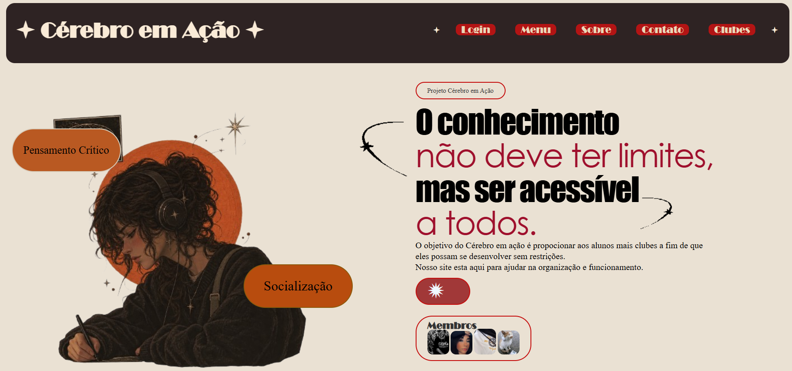

# Apresentação Shark Tank

# Objetivo:
Nosso projeto tem como objetivo aumentar a quantidade de clubes e eventos na escola, porque muitos alunos advertem sobre a falta de atividades extra curriculares que são muito importantes para o desenvolvimento das habilidades sociais e criativas do aluno.

# Pesquisa de Campo

1ª Pergunta: Quem sente falta de mais clubes e eventos na escola?
Os resultados da pesquisa de campo mostraram que há uma grande demanda dos alunos por mais clubes e eventos escolares. Em todas as turmas entrevistadas, a maioria dos estudantes afirmou sentir falta dessas atividades:

•	9ºA: 25 alunos 

•	9ºB: 14 alunos

•	1ºA: 24 alunos

•	1ºB: 19 alunos

•	2ºA: 19 alunos

•	2ºB: 22 alunos

•	3ºA: 28 alunos

•	3ºB: 20 alunos 

Esses dados demonstram que o interesse por mais atividades extracurriculares é significativo em diferentes séries, reforçando a necessidade de ampliar os espaços de participação dentro da escola.

2ª Pergunta: Ideias de clubes sugeridas pelas salas
Durante a pesquisa, os alunos também sugeriram diversas ideias de clubes e atividades que gostariam de ver na escola. Entre as mais citadas, destacam-se:

•	Clube de esportes (futebol, basquete, vôlei, corrida e outras modalidades) 

•	Clube de artes (pintura, desenho, música e teatro) 

•	Feira de ciências e projetos experimentais 

•	Clube de leitura e debates 

Essas sugestões mostram o interesse dos estudantes por atividades diversificadas que vão além da sala de aula.

# Importância

Atividades extracurriculares transformam o estudante de um espectador passivo em um protagonista da sua própria formação, unindo teoria, prática e convivência social.

* Liderança: Assumir responsabilidades em projetos ou cargos de diretoria.
* Trabalho em Equipe: Aprender a lidar com opiniões divergentes e colaborar por um objetivo comum.
* Gestão de Tempo: Conciliar os estudos com as responsabilidades extras.
Muitas vezes, é em um clube de robótica, teatro ou jornalismo que o estudante descobre sua verdadeira vocação.

# Link do Protótipo do Canvas
[Protótipo](https://canva.link/ixee6juxcn0uq9w)

_______________________________________________________________________________________________________________________________________________________________

# Atualizações do Projeto:

## Front-end: 

- Desenvolvido por: Maria Eduarda Betim Gomes de Moraes

- Tecnologia: HTML5 • CSS3

- Projetos: Cérebro em Ação
  
### Código(não finalizado): 
* [Html](./html)
  
* [css](./css)

## Alguns prints do site em andamento:

(A imagem da moça foi feita de IA!!)

## O que foi feito:

* #### Design e Interface:
  Criação de um layout com estilo único e bonito, além de usar paleta de cores que nós escolhemos e utilizamos no site no canvas.

* #### Estruturação:
  Organização de todas as secções, menus de navegação e cabeçalho.

* #### Estilização CSS:
   Ajuste detalhado de posicionamentos, transições, botões e alinhamentos responsivos.

### Aviso!!: Eu e meu grupo decidimos mudar o estilo de dentro do site totalmente, só usamos o do canvas de base.
_______________________________________________________________________________________________________________________________________________________________

## Banco de Dados: 

- Desenvolvido por: Yasmin Drudi

- Tecnologia: Banco de Dados

- Projetos: Cérebro em Ação

  ### Código:

  * [dml](./dml)

  * [ddl](./ddl)

## O que foi feito:

* ### Modelagem de Dados:
  Criação da estrutura e tabelas para armazenamento de informações.

* ### Integração & Consultas:
  Organização de dados para acesso rápido e dinâmico pela plataforma.

* ### Gestão de Informações:
  Estruturação para cadastro e controle de membros e conteúdos.
